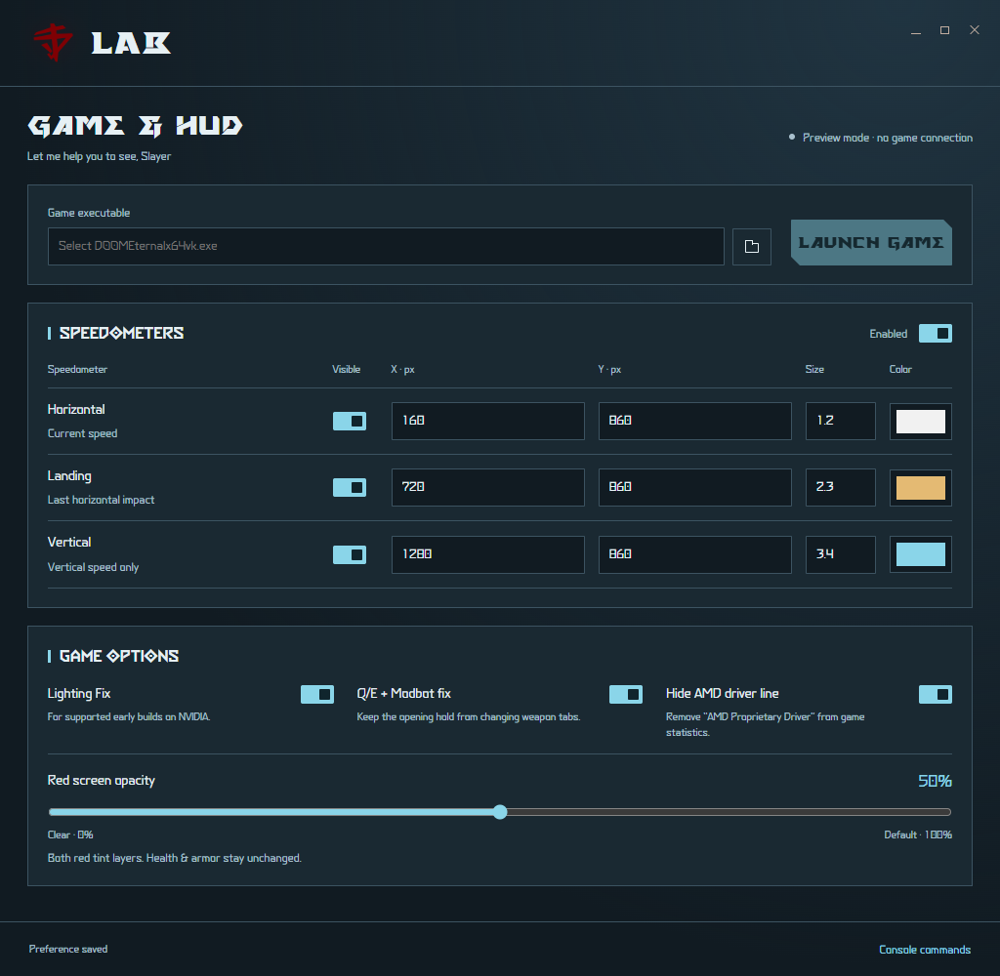

# LAB

LAB is a focused DOOM Eternal utility with a UAC Frost interface, the original red emblem and the bundled Eternal typefaces. All application text is English. LAB Plus remains a separate application.



## Run

Extract the complete archive and open `lab.exe`. Windows x64, .NET 10 Desktop Runtime and Microsoft Edge WebView2 Runtime are required. Choose `DOOMEternalx64vk.exe`, set preferences, then click **Launch game**. LAB can also connect to an already running copy whose full executable path matches the selected path.

Keep LAB open for live HUD updates, console settings, tint control and Q/E protection. Preferences are saved in `%LOCALAPPDATA%\lab\settings.json`, independently of LAB Plus. `LAB_DATA_DIRECTORY` may override this with an absolute directory. Logs are written there as `lab.log`.

## Features

- **Lighting Fix**: Vulkan synchronization correction for the audited early 1.0, 1.1 and 2.0 executables on NVIDIA. Launch the game through LAB to load the layer; the switch can then change its active state. Enabling it for an externally launched game requires a restart through LAB. Other executable/GPU combinations pass through without changing barriers. The layer is enabled only in the launched child's environment; no global Vulkan registry entries or game files are installed. Some Windows Vulkan loaders require an ASCII path for layer manifests. If the Windows profile path contains non-ASCII characters and lighting fails to load, choose an ASCII `LAB_DATA_DIRECTORY`.
- **Horizontal speed**: `sqrt(vx² + vy²)`, in m/s.
- **Landing speed**: horizontal speed at ground contact, retaining the impact peak from the following 8 ms. Attaching while already grounded does not count as landing.
- **Vertical speed**: `abs(vz)`, in m/s, with two decimals and no direction sign.
- **Independent HUD controls**: each meter has its own visibility, X/Y physical-pixel coordinates from the top left, text size (0.1–10) and RGB text color. Size 1 corresponds to the original native HUD scale. The game draws the numeric values itself; there is no separate desktop HUD window. Readings hide outside gameplay, while unfocused/loading, or after the update heartbeat expires. `--` means no valid reading/landing yet.
- **Q/E + Modbot fix**: prevents Q or E held while opening the Modbot from repeatedly changing weapon tabs. Fresh navigation resumes after release and the queued release event drains. This preserves the upstream internal-FPS-cap condition below 1000 Hz. It does not remap keys or add an FPS limiter.
- **Red screen opacity**: 0–100% of the original low-health tint, applied to both identified tint layers. It does not change health, armor or damage.
- **Hide AMD driver line**: hides only the `AMD Proprietary Driver` statistics string. Other statistics stay intact. Disabling the option or closing LAB restores the byte owned by LAB when the same game string still exists.

The UI contains no tint/HUD previews or invented live numbers. Window buttons use the LAB Plus geometry. The first visible window frame appears after local fonts, logo and WebView2 content are ready; the only native child is the WebView2 host.

## Console commands

Commands register in the game's console after the native HUD initializes. They do not require cheats. Run any command without arguments to print its current value and usage. Valid changes persist to the same preferences used by the UI.

| Command | Behavior |
| --- | --- |
| `lab_speedometer_show <0\|1> [current\|landing\|vertical]` | Overall visibility, or one meter. The overall switch retains secondary preferences. |
| `lab_speedometer_showlanding <0\|1>` | Landing meter visibility. |
| `lab_speedometer_showvertical <0\|1>` | Vertical magnitude meter visibility. |
| `lab_speedometer_x_pos <pixels> [current\|landing\|vertical]` | X position; omit the target to change all three. |
| `lab_speedometer_y_pos <pixels> [current\|landing\|vertical]` | Y position; omit the target to change all three. |
| `lab_speedometer_size <0.1..10> [current\|landing\|vertical]` | Independent text size; omit the target to change all three. |
| `lab_speedometer_color <R> <G> <B> [current\|landing\|vertical]` | Integer RGB channels 0–255; omit the target to change all three. |
| `lab_lowhptintopacity <0..100>` | Both red tint layers; 100 restores the original opacity. |

Examples:

```text
lab_speedometer_size 1.2 current
lab_speedometer_size 0.8 landing
lab_speedometer_size 1.5 vertical
lab_speedometer_color 138 213 233 vertical
lab_speedometer_showvertical 1
lab_lowhptintopacity 35
```

Lighting Fix, Q/E protection and driver-line hiding are controlled by the LAB switches. No unrelated DESRU commands are registered. Do not run LAB and LAB Plus/DESRU HUD controls against the same game process at the same time; foreign hooks are detected and retained rather than overwritten.

## Compatibility and validation

Telemetry uses exact executable hashes from `Assets/game-profiles.json`; native HUD/input/tint layouts are independently resolved from the executable's metadata and checked against the loaded image. Unknown or modified builds are refused with an English status message. The Game Pass placeholder profile is not a verified hash and is not accepted automatically. Per-feature metadata failures are reported, with original behavior retained.

This local build has passed executed x64 fixture checks for all three draws, separate scales, eight command callbacks, the input guard and both tint paths; Vulkan loader/device/command recording checks; and actual WebView2 UI checks for fonts, settings persistence, window controls and first-frame readiness. Live-game acceptance testing of this new LAB build is still required. No running game was modified for these checks. The 1 ms velocity worker is sampled telemetry; scheduling stalls can miss an exceptionally short landing impulse.

See [CREDITS.md](CREDITS.md), `LICENSE` and `Assets/licenses` for attribution.

## Build locally

Clone this repository and run `pwsh -File build.ps1` from its root. Install the .NET 10 SDK, PowerShell 7 and LLVM-MinGW (`clang++`) on PATH. If the parent workspace contains `.tools/dotnet` and `.tools/llvm-mingw-20261020-ucrt-x86_64`, the build uses those toolchains instead. Vulkan headers are included under `third_party`.

The script compiles the light-only Vulkan DLL, publishes the application to `publish`, and writes `artifacts/lab-0.1.0-win-x64.zip` plus a SHA-256 file. Add `-Test` for native fixtures and the Vulkan probe. The native library must be compiled before running `dotnet publish` directly. UI sources and bundled assets are checked in; no external design workspace or UI generator is required to build.

`lab.exe --preview` starts an isolated design preview without connecting to or launching a game. `--qa-output <absolute-directory>` additionally saves screenshots and UI reports, exercises settings/window controls, then closes. Run UI QA in the normal Windows user session so WebView2 subprocess creation is available.
