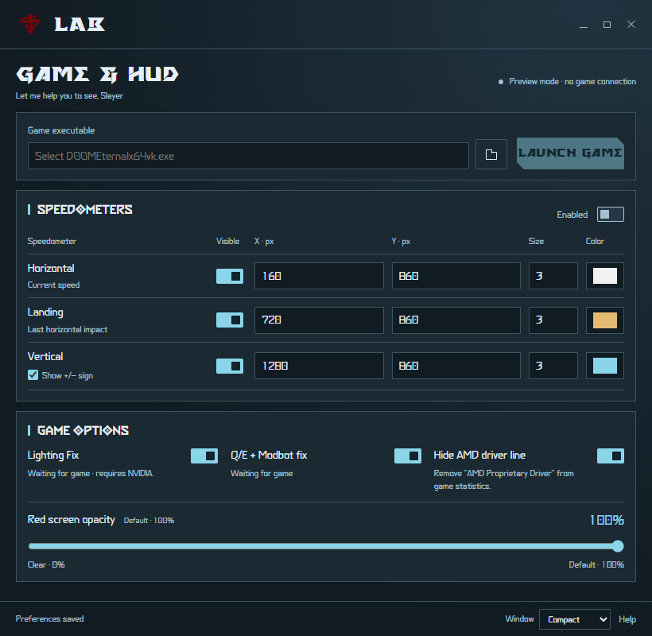

# LAB

**A simpler way to practice DOOM Eternal.**

LAB is a free Windows tool for DOOM Eternal that helps you track movement, fix common annoyances and adjust the in-game display for speedrunning practice.

Everything in one compact, customizable interface.

[**Download Latest Release**](https://github.com/IlyaTsyganov/LAB/releases/latest) • [**Report an Issue**](https://github.com/IlyaTsyganov/LAB/issues)

## Features

- **Speedometers** — Track horizontal speed, landing speed and vertical movement directly in the game.
- **Customizable HUD** — Choose the position, size and color of each speedometer.
- **Lighting Fix** — Correct lighting issues in supported early versions of the game on NVIDIA graphics cards.
- **Q/E + Modbot Fix** — Prevent held Q or E keys from repeatedly switching weapon tabs when opening a Modbot.
- **Red Screen Opacity** — Adjust the intensity of the red screen effect at low health.
- **Cleaner Performance Display** — Hide the driver line and hardware labels while keeping useful performance information.

LAB supports multiple versions of DOOM Eternal. Feature availability may vary depending on the game version and hardware.

## Download & Installation

1. Download `LAB.zip` from the [Releases page](https://github.com/IlyaTsyganov/LAB/releases/latest).
2. Extract the entire archive and keep all included files together.
3. Open the extracted `LAB` folder and run `LAB.exe`.
4. Select `DOOMEternalx64vk.exe`, choose your settings and click **Launch game**.

**Requirements:** Windows 64-bit, .NET 10 Desktop Runtime (x64) and Microsoft Edge WebView2 Runtime.

Keep LAB open while playing. If the game is already running outside LAB, close it and launch it through LAB so its features can work.

Your preferences are saved automatically.

## Need Help?

Open **Help** inside LAB for explanations of the in-game indicators and available console commands.

Found a bug or have a suggestion? Open an [issue on GitHub](https://github.com/IlyaTsyganov/LAB/issues).

## Purpose & Disclaimer

LAB is developed for educational, research and practice purposes, with a particular focus on understanding DOOM Eternal's game mechanics and improving speedrunning knowledge and techniques.

The software is not intended to provide an unfair advantage over other players, facilitate cheating in competitive environments or interfere with the experience of other users.

LAB is an independent, unofficial community project. The author does not claim ownership of DOOM Eternal or any associated trademarks, copyrights, game assets or other intellectual property. All respective rights remain with their original owners. No infringement of third-party rights is intended.

LAB is not affiliated with, sponsored by or endorsed by id Software, Bethesda Softworks or their respective parent companies.

**Use at your own risk.** The software is provided "as is", without warranties of any kind. The author assumes no responsibility for crashes, data loss, game instability, account restrictions or other consequences arising from its use, to the extent permitted by applicable law.

Users are responsible for complying with applicable game and platform terms of service, as well as the rules of any speedrunning communities or events in which they participate.

---

Licensed under [GNU GPL v3](LICENSE). Third-party licenses and notices are included in the application package.
